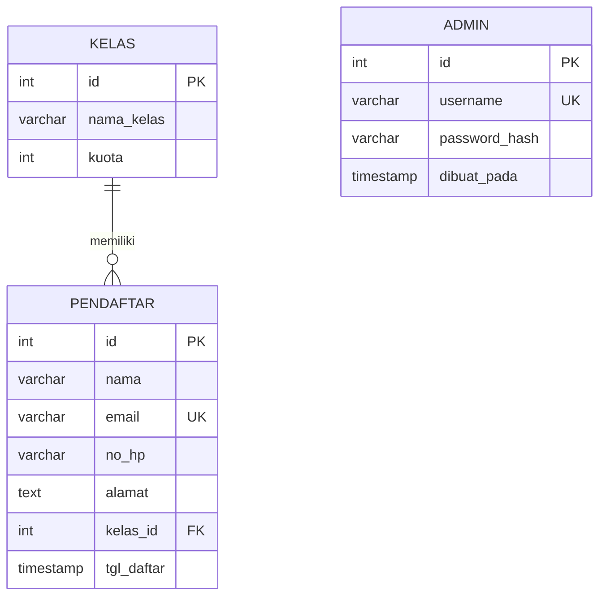

# ERD — Sistem Pendaftaran Pelatihan

## Relasi dan aturan
- **KELAS 1 — N PENDAFTAR:** satu kelas dapat memiliki banyak pendaftar; satu pendaftar memilih satu kelas.
- `kelas.id` adalah primary key dan direferensikan oleh `pendaftar.kelas_id`.
- `pendaftar.email` harus unik.
- `ON DELETE RESTRICT` mencegah kelas dihapus ketika masih memiliki pendaftar.
- `ON UPDATE CASCADE` meneruskan perubahan ID kelas ke foreign key.
- Tabel `admin` adalah rancangan untuk Hari 11 dan belum dibuat pada skema Sprint 0. Kata sandi disimpan sebagai hash `password_hash`, bukan teks polos.
