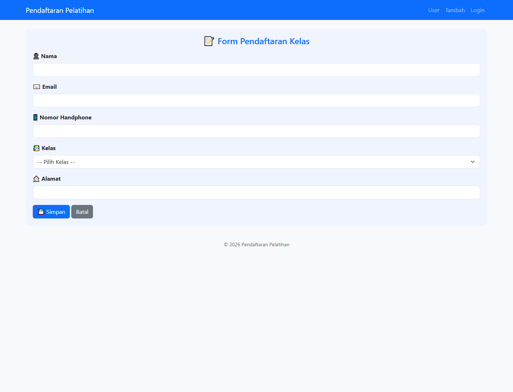
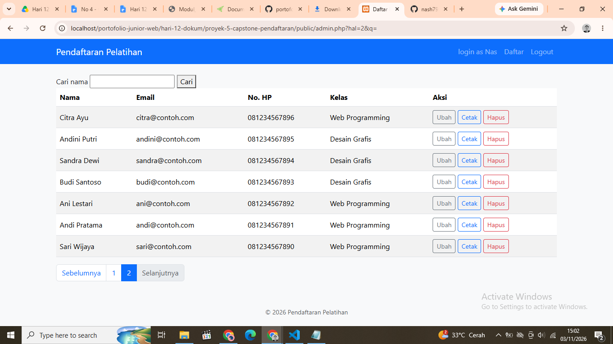
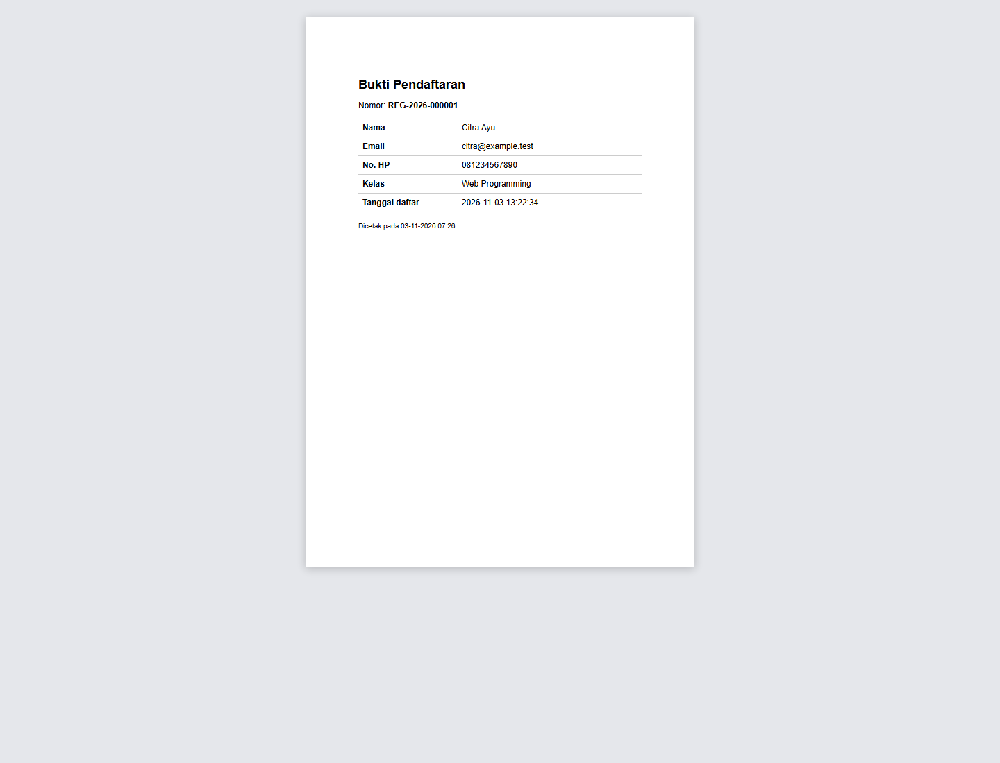

# No. 4 — Rilis dan Uji Instalasi Capstone

## Repositori dan tag

- **Repositori Capstone:** [nash792/portofolio-junior-web](https://github.com/nash792/portofolio-junior-web/tree/main/hari-12-dokum/proyek-5-capstone-pendaftaran)
- **Sumber rilis `v1.0.0`:** [Capstone pada tag v1.0.0](https://github.com/nash792/portofolio-junior-web/tree/v1.0.0/hari-12-dokum/proyek-5-capstone-pendaftaran)
- **Halaman rilis:** [Release v1.0.0](https://github.com/nash792/portofolio-junior-web/releases/tag/v1.0.0)

**Status tag:** `v1.0.0` belum ditemukan di tag lokal maupun pada `origin` saat catatan ini dibuat. Tautan rilis di atas menjadi aktif setelah perubahan rilis sudah di-commit, tag dibuat pada commit tersebut, lalu tag didorong ke GitHub. Jangan membuat tag rilis pada commit lama yang belum berisi file Capstone Hari 12.

Setelah commit rilis siap, buat dan dorong tag dari root repositori:

```powershell
git tag -a v1.0.0 -m "Capstone pendaftaran versi 1.0.0"
git push origin v1.0.0
```

## Tangkapan layar aplikasi

Tangkapan layar menggunakan data contoh untuk dokumentasi; bukan data pendaftar produksi.

### Form pendaftaran



### Panel admin



### Bukti pendaftaran PDF



## Catatan uji instalasi dari nol

**Tanggal pemeriksaan:** 3 November 2026  
**Status keseluruhan:** instalasi bersih dan uji alur HTTP lulus menggunakan PHP CLI lokal 8.5.12, MySQL/MariaDB, salinan proyek terisolasi, dan database sementara.

| Pemeriksaan | Hasil |
|---|---|
| PHP lokal | **Lulus:** PHP 8.5.12 x64 NTS di `%LOCALAPPDATA%\Tools\php-8.5.12`; `pdo_mysql`, `pdo_sqlite`, `sqlite3`, dan `mbstring` aktif. Instalasi PHP ini berdampingan dengan XAMPP dan tidak mengubah PATH. |
| Prasyarat Windows | Build PHP resmi membutuhkan Visual C++ Runtime yang lebih baru; Microsoft Visual C++ Redistributable x64 14.44.35211.0 (installer bertanda tangan resmi) dipasang sebagai prasyarat Windows. |
| PHP pada Apache XAMPP | Tetap menggunakan PHP 8.0.30. Uji HTTP bersih dijalankan melalui PHP built-in server 8.5.12, bukan Apache XAMPP. |
| MySQL/MariaDB | **Tersedia:** layanan menjawab saat pengujian. |
| Dependensi PDF | `hari-12-dokum/vendor/autoload.php` tersedia; endpoint PDF menghasilkan berkas dengan signature `%PDF-`. |
| Impor skema dari database kosong | **Lulus:** `database/skema.sql` menghasilkan tabel `admin`, `kelas`, dan `pendaftar` dalam database uji baru. |
| Uji regresi pada PHP 8.5.12 | **Lulus:** `php tests/regresi.php` menghasilkan 17 LOLOS, 0 GAGAL. |
| Uji HTTP instalasi bersih | **Lulus:** form dan POST pendaftaran beserta redirect tanpa PHP warning, penolakan kelas penuh, autentikasi admin, akses panel, pencarian, penolakan edit ke kelas penuh tanpa mengubah data awal, pembuatan PDF, dan logout terlindungi CSRF. |
| Uji selesai | Salinan aplikasi dan database sementara yang dipakai untuk pengujian telah dihapus; konfigurasi lokal proyek asli tidak diubah. |

### Menjalankan dengan PHP lokal

Dari root proyek Capstone, jalankan PHP berdampingan dengan XAMPP:

```powershell
$php = "$env:LOCALAPPDATA\Tools\php-8.5.12\php.exe"
$ini = "$env:LOCALAPPDATA\Tools\php-8.5.12\php.ini"
& $php -c $ini -S 127.0.0.1:8000 -t public
```

Pastikan Apache XAMPP tidak sedang memakai port `8000`. Konfigurasi database aplikasi tetap disimpan secara lokal di `config/config.php`.

### Langkah untuk mengulang instalasi bersih

1. Pasang PHP **8.1 atau lebih baru** dengan ekstensi `pdo_mysql` dan `mbstring`, MySQL/MariaDB, serta Apache.
2. Clone repositori. Setelah tag rilis tersedia, checkout kode Capstone yang sesuai:

   ```powershell
   git clone https://github.com/nash792/portofolio-junior-web.git
   Set-Location portofolio-junior-web
   git checkout v1.0.0
   Set-Location hari-12-dokum\proyek-5-capstone-pendaftaran
   ```

3. Jalankan Apache dan MySQL/MariaDB. Pastikan PHP yang dipakai CLI dan Apache memenuhi persyaratan versi aplikasi.
4. Buat database dan tabel dari awal dengan mengimpor `database/skema.sql` melalui phpMyAdmin atau MySQL CLI.
5. Siapkan kelas dan pendaftar contoh. **Jangan menjalankan seluruh `database/latihan.sql`** untuk setup bersih: file itu juga menjalankan UPDATE, DELETE, serta query yang memang dirancang gagal.
6. Salin `config/config.contoh.php` menjadi `config/config.php`, lalu isi kredensial database lokal.
7. Buat akun admin dari root proyek:

   ```powershell
   php database/buat-admin.php <username> <kata-sandi>
   ```

   Username minimal 3 karakter dan kata sandi minimal 8 karakter.
8. Jalankan Apache, buka folder `public/` melalui browser, lalu verifikasi:
   - Form pendaftaran di `public/tambah.php`.
   - Login dan daftar admin di `public/login.php` dan `public/admin.php`.
   - Tambah, ubah, dan hapus data serta penolakan ketika kelas penuh.
   - Endpoint `public/cetak.php?id=<id>` menghasilkan PDF bukti.
9. Jalankan `php tests/regresi.php` dari root proyek; catat hasil uji browser dan database secara terpisah dari tes regresi.

Langkah konfigurasi rinci dan fitur aplikasi tersedia di [README Capstone](proyek-5-capstone-pendaftaran/README.md); alur setiap endpoint dijelaskan di [dokumentasi arsitektur](proyek-5-capstone-pendaftaran/docs/arsitektur.md).
