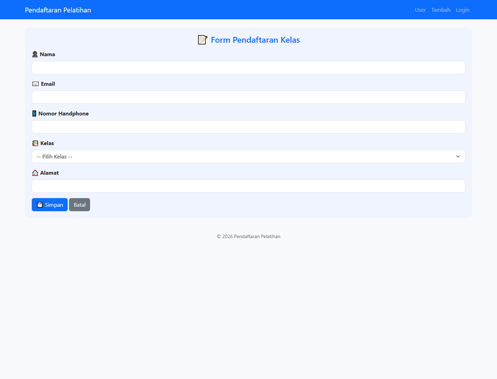
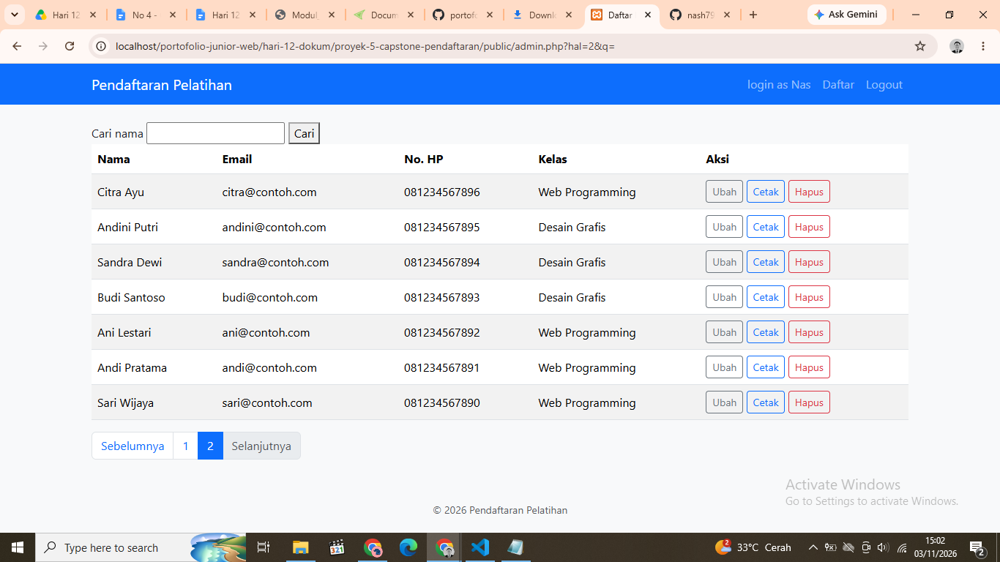
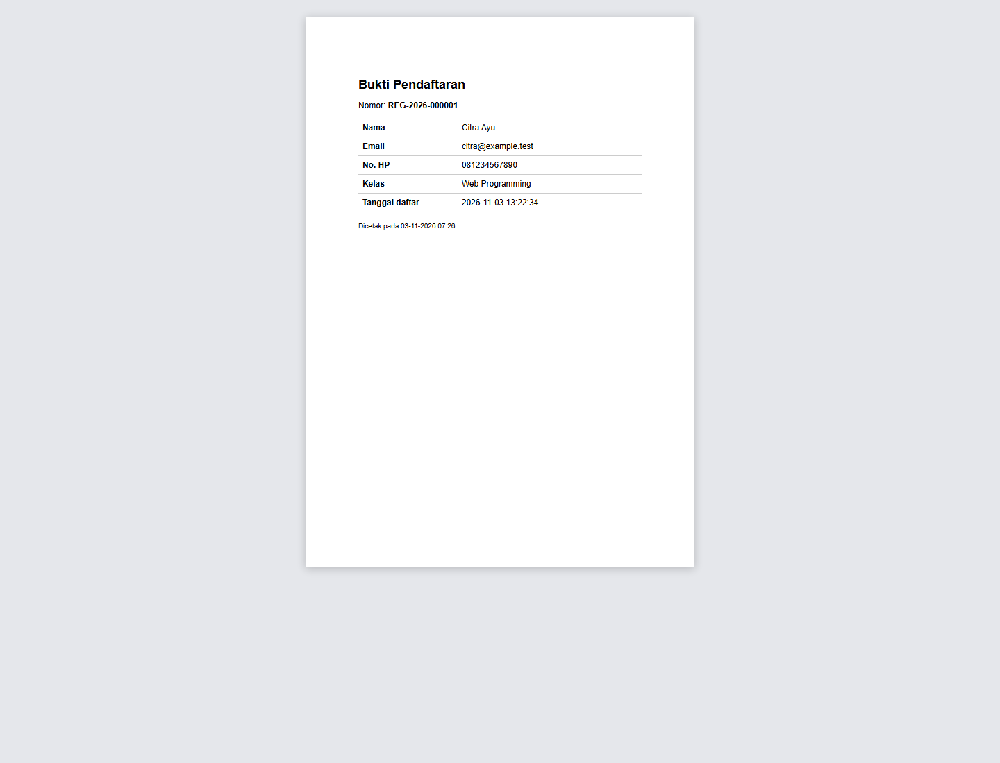

# Capstone — Sistem Pendaftaran Pelatihan

Aplikasi web untuk pendaftaran pelatihan dan pengelolaan peserta oleh admin. Proyek ini menggunakan PHP, MySQL/MariaDB, PDO, Bootstrap, dan Dompdf.

## Fitur

- Form pendaftaran dengan validasi server-side dan pemeriksaan email unik.
- Pengecekan kuota kelas secara transaksional saat pendaftaran maupun perubahan kelas.
- Login admin dengan verifikasi `password_hash()`, pencarian, dan paginasi daftar peserta.
- Dashboard admin dengan lima pendaftar terbaru, sepuluh aktivitas admin terakhir, dan peringkat kelas.
- Pengelolaan kelas oleh admin melalui `public/kelas.php`, termasuk pengaturan kuota.
- Operasi tambah, ubah, dan hapus dengan prepared statement serta perlindungan CSRF.
- Bukti pendaftaran dalam format PDF.
- Escape output HTML, flash message, dan pola Post/Redirect/Get (PRG).

## Tangkapan layar

| Form pendaftaran | Panel admin | Bukti PDF |
|---|---|---|
|  |  |  |

Tangkapan layar berada di [`docs/gambar/`](docs/gambar/).

## Dashboard admin dan struktur data

Dashboard menampilkan ringkasan jumlah pendaftar, lima pendaftar terbaru, aktivitas admin selama sesi login, peringkat kelas berdasarkan jumlah pendaftar, dan tabel pendaftar yang dapat dicari serta dipaginasi. Aktivitas login, perubahan data, penghapusan, dan penambahan kelas dicatat; riwayat disimpan di sesi dan hanya menampung sepuluh kejadian terbaru.

Admin dapat menambah, mengedit nama/kuota, dan menghapus kelas tanpa pendaftar melalui menu **Kelola Kelas**. `public/kelas.php` memuat form dari `public/_form_kelas.php`; proses tambah, ubah, dan hapus memakai endpoint terpisah. Kuota kelas yang diedit tidak boleh lebih kecil dari jumlah pendaftar saat ini. Form memiliki tombol **Reset Form** untuk kembali ke mode tambah dengan kuota awal 30. Form pendaftaran peserta tetap tersedia untuk calon peserta melalui **Tambah Pendaftar**, bukan sebagai aksi dashboard admin.

| Kebutuhan | Struktur dipilih | Alasan | Alternatif |
|---|---|---|---|
| Menampilkan lima pendaftar terbaru | `SplQueue` dengan hasil query `LIMIT 5` | Antrean mempertahankan urutan hasil, membatasi data sejak query, dan sesuai untuk traversal FIFO | Array terbatas dengan `array_slice()` |
| Menyimpan sepuluh aktivitas admin terbaru | `SplStack` dalam sesi, dibatasi menjadi 10 entri | Aktivitas terbaru mudah ditambahkan di puncak dan dibaca dari yang terbaru ke terlama | Tabel log di database untuk riwayat lintas sesi/perangkat |
| Memeringkat kelas berdasarkan jumlah pendaftar | Array asosiatif dan `usort()` | Data hitungan dapat dipasangkan dengan nama kelas dan diurutkan menurun; kelas kosong tetap terlihat melalui `LEFT JOIN` | `ORDER BY COUNT(...)` di query SQL |

## Persyaratan

- PHP 8.1 atau lebih baru dengan ekstensi `pdo_mysql` dan `mbstring`.
- MySQL/MariaDB dan Apache (contohnya XAMPP).
- Browser modern.
- Dependensi Dompdf tersedia melalui `vendor/autoload.php` pada direktori `hari-12-dokum/`.

## Instalasi dan menjalankan

1. Tempatkan repositori di document root Apache, lalu jalankan Apache dan MySQL/MariaDB.
2. Impor `database/skema.sql` melalui phpMyAdmin atau MySQL CLI. Database `db_pelatihan` dan tabel `kelas`, `pendaftar`, serta `admin` akan dibuat.
3. Isi tabel `kelas` dan `pendaftar` dengan data pelatihan. Untuk data contoh, jalankan hanya dua pernyataan `INSERT` di bagian awal `database/latihan.sql`; bagian selanjutnya adalah latihan yang mengubah atau menghapus data dan mencakup query yang memang dirancang gagal.
4. Salin `config/config.contoh.php` menjadi `config/config.php`, lalu sesuaikan host, nama database, username, dan sandi. Jangan commit `config.php`.
5. Buat akun admin dari root proyek:

   ```bash
   php database/buat-admin.php <username> <kata-sandi>
   ```

   Username minimal 3 karakter dan kata sandi minimal 8 karakter.
6. Buka URL berikut di browser:

   ```text
   http://localhost/portofolio-junior-web/hari-12-dokum/proyek-5-capstone-pendaftaran/public/
   ```

   Sesuaikan bagian path apabila nama folder repositori berbeda. Form pendaftaran tersedia di `tambah.php`; panel admin memerlukan login melalui `login.php`.

## Struktur proyek

```text
proyek-5-capstone-pendaftaran/
├── config/                 # konfigurasi contoh dan koneksi PDO
├── database/               # skema, latihan SQL, dan pembuatan akun admin
├── docs/                   # dokumentasi, laporan, dan tangkapan layar
├── public/                 # endpoint web dan aset publik
├── src/                    # autentikasi, helper, dan logika pendaftar
├── templates/              # layout halaman dan template bukti PDF
├── tests/                  # pengujian regresi
└── README.md
```

Rincian tanggung jawab berkas dan alur request dijelaskan di [`docs/arsitektur.md`](docs/arsitektur.md). ERD awal dari Hari 9 tersedia di [dokumentasi ERD](../../hari-09-sql/proyek-5-capstone-pendaftaran/docs/erd.md).

## Pengujian

Jalankan pengujian regresi dari root proyek:

```bash
php tests/regresi.php
```

Pengujian regresi menggunakan SQLite in-memory untuk kasus yang tidak memerlukan server database. Uji transaksi kuota, autentikasi, dan alur PDF tetap memerlukan MySQL/MariaDB serta server web. Lihat [`docs/kasus-uji.md`](docs/kasus-uji.md) untuk skenario dan status pengujian integrasi.

## Keamanan dan konfigurasi

- `config/config.php` berisi kredensial lokal dan tidak boleh dimasukkan ke Git.
- Gunakan akun database dengan hak minimum pada lingkungan produksi.
- Detail exception dicatat ke error log, bukan ditampilkan kepada pengunjung.
- Arahkan document root Apache ke `public/` pada deployment produksi.
- `public/injeksi.php` hanya untuk demonstrasi lokal; jangan publikasikan ke server produksi.

## Dokumentasi terkait

- [Arsitektur aplikasi](docs/arsitektur.md)
- [Peta modul](docs/peta-modul.md)
- [Temuan Doc Hunt](docs/doc-hunt.md)
- [Kasus uji](docs/kasus-uji.md)
- [Laporan bug T7](docs/laporan-bug.md)
- [Changelog](CHANGELOG.md)
