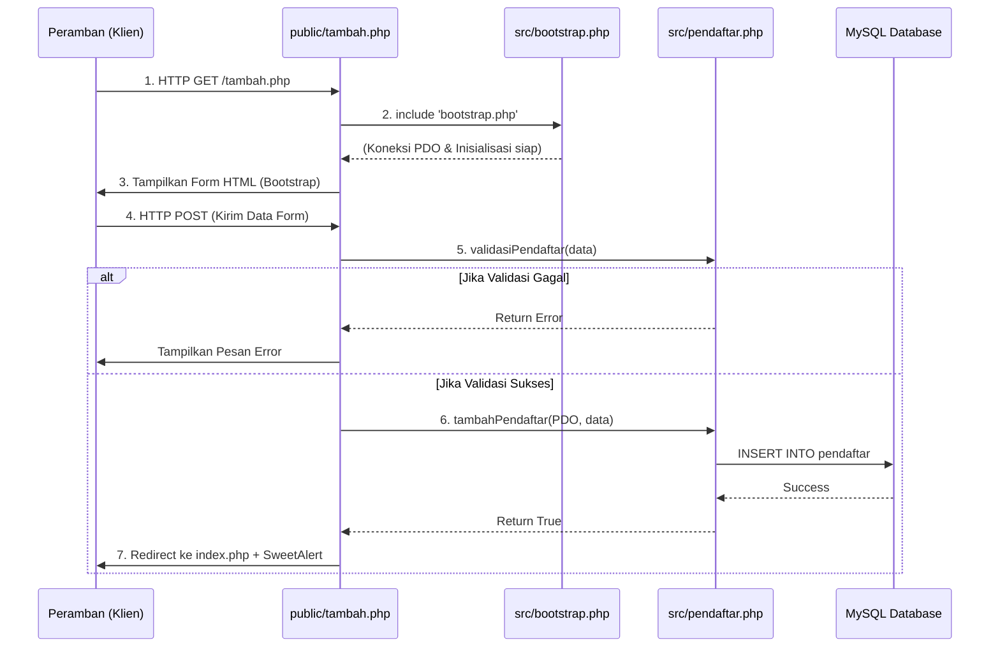
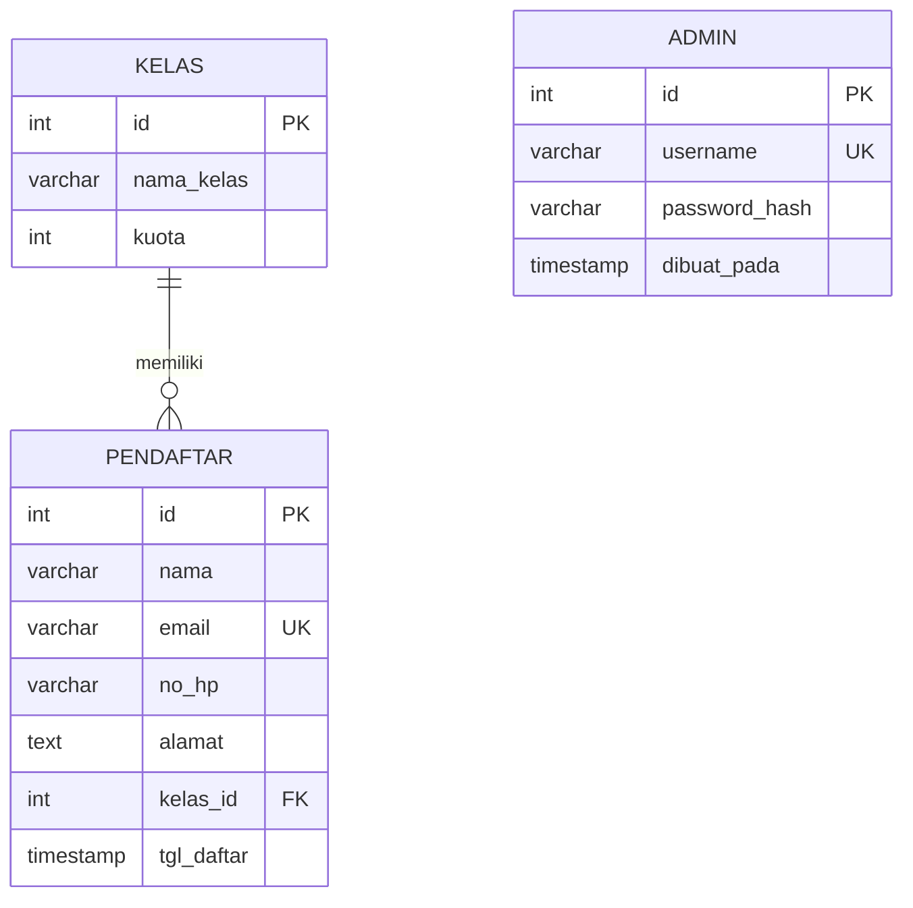

# Arsitektur Sistem Pendaftaran Pelatihan

## Struktur folder

```text
proyek-5-capstone-pendaftaran/
├── config/
│   ├── config.contoh.php    # contoh konfigurasi lokal
│   └── database.php         # koneksi PDO ke MySQL/MariaDB
├── database/
│   ├── skema.sql            # database, tabel, indeks, dan foreign key
│   ├── latihan.sql          # data contoh dan latihan query Hari 9
│   └── buat-admin.php       # utilitas CLI untuk membuat akun admin
├── docs/                    # arsitektur, pengujian, laporan, dan gambar
├── public/                  # document root dan endpoint HTTP
│   ├── _form.php            # partial form tambah/ubah
│   ├── index.php            # halaman sambutan
│   ├── tambah.php           # form serta proses pendaftaran
│   ├── login.php            # autentikasi admin
│   ├── admin.php            # dashboard, daftar, pencarian, dan paginasi
│   ├── kelas.php            # penambahan kelas dan ringkasan kuota (admin)
│   ├── _form_kelas.php      # partial form tambah/ubah kelas
│   ├── tambah_kelas.php     # proses penambahan kelas
│   ├── ubah_kelas.php       # proses perubahan kelas
│   ├── hapus_kelas.php      # proses penghapusan kelas
│   ├── ubah.php             # form serta proses perubahan peserta
│   ├── hapus.php            # proses penghapusan peserta
│   ├── cetak.php            # pembuatan bukti PDF
│   └── logout.php           # proses logout
├── src/
│   ├── bootstrap.php        # sesi, konfigurasi, modul, dan handler exception
│   ├── auth.php             # autentikasi dan siklus sesi admin
│   ├── helpers.php          # escaping, redirect, flash, dan CSRF
│   ├── dashboard.php        # ringkasan, antrean terbaru, peringkat, dan riwayat admin
│   └── pendaftar.php        # validasi serta akses data kelas/pendaftar
├── templates/
│   ├── header.php           # navigasi dan pembuka layout
│   ├── footer.php           # penutup layout dan aset antarmuka
│   └── bukti.php            # isi HTML untuk bukti pendaftaran
├── tests/
│   └── regresi.php          # pengujian regresi
└── README.md
```

`config/config.php` dibuat dari file contoh untuk konfigurasi lokal dan dikecualikan dari Git. Pustaka Dompdf dimuat melalui `vendor/autoload.php`.

---

## Alur Permintaan (Request Flow)

Aplikasi ini menggunakan pola **prosedural modular**. Setiap halaman di dalam `public/` bertindak sebagai *Controller* sederhana yang memanggil logika dari folder `src/`.

Berikut adalah siklus standar ketika klien (*browser*) mengakses sebuah halaman (contoh: Menambah Pendaftar):



**Penjelasan Singkat:**
1. Pengguna membuka URL di folder `public/`.
2. Halaman tersebut wajib memuat `src/bootstrap.php` terlebih dahulu untuk menyiapkan fungsi bawaan dan koneksi *database* (`PDO`).
3. Jika halaman butuh keamanan (misal `ubah.php` atau `hapus.php`), halaman akan memanggil `wajibLogin()` dari `src/auth.php`.
4. Jika ada proses simpan/hapus, logika diproses menggunakan fungsi dari `src/pendaftar.php`.
5. Hasil dikembalikan ke pengguna (berupa tampilan HTML atau notifikasi SweetAlert2/Flash message).

---
## Alur request

### Pendaftaran

1. Browser meminta `GET public/tambah.php`. Endpoint memuat `src/bootstrap.php`, membuka sesi, memuat helper dan logika aplikasi, lalu mengambil pilihan kelas dari database.
2. `public/_form.php` menampilkan form dengan token CSRF.
3. Saat form dikirim dengan `POST`, endpoint memeriksa token CSRF dan menjalankan `validasiPendaftar()` untuk memeriksa data, kelas, serta email unik.
4. Jika valid, `daftarkanDenganKuota()` memulai transaksi, mengunci baris kelas, memeriksa kapasitas, menyimpan pendaftar, lalu commit. Jika kuota penuh atau penyimpanan gagal, transaksi di-rollback.
5. Endpoint menyimpan pesan flash dan mengarahkan browser dengan pola Post/Redirect/Get. Pesan ditampilkan pada request berikutnya.

### Panel admin dan pengelolaan peserta

1. Admin mengirim kredensial ke `POST public/login.php`; token CSRF diperiksa dan `prosesLogin()` memverifikasi hash kata sandi.
2. Setelah autentikasi berhasil, ID admin disimpan di sesi dan ID sesi diregenerasi. Endpoint admin memanggil `wajibLogin()` sebelum menampilkan data.
3. `public/admin.php` menampilkan lima pendaftar terbaru melalui `SplQueue`, sepuluh aktivitas sesi melalui `SplStack`, dan peringkat kelas yang diurutkan dengan `usort()`. Daftar pendaftar membaca kata kunci dan nomor halaman, menghitung jumlah kecocokan, lalu mengambil maksimal 10 baris dengan prepared statement.
4. Login berhasil, perubahan, penghapusan, dan penambahan kelas dicatat ke riwayat sesi admin yang dibatasi sepuluh entri. `public/kelas.php` menampilkan daftar kelas dan memuat partial `public/_form_kelas.php`; proses tambah, ubah, dan hapus ditangani endpoint POST `public/tambah_kelas.php`, `public/ubah_kelas.php`, dan `public/hapus_kelas.php`. Setiap endpoint memeriksa autentikasi admin dan token CSRF. Kelas yang sudah memiliki pendaftar tidak dapat dihapus. Perubahan data pendaftar diproses oleh `public/ubah.php`; validasi dan pemeriksaan kuota dilakukan sebelum update. Penghapusan pendaftar dikirim ke `public/hapus.php` dengan metode POST dan token CSRF.
5. Logout hanya menerima POST bertoken CSRF dan menghapus data sesi serta cookie sesi.

### Bukti PDF

1. Panel admin membuka `public/cetak.php` dengan ID pendaftar.
2. Endpoint memeriksa autentikasi admin dan memvalidasi ID. Data peserta dan nama kelas diambil melalui prepared statement.
3. `templates/bukti.php` menghasilkan markup HTML dengan output ter-escape. Dompdf mengubahnya menjadi PDF A5 dan mengirimkannya ke browser.

Request yang menimbulkan exception tak tertangani dicatat ke error log dan mendapat respons kesalahan umum; detail exception tidak ditampilkan kepada pengunjung.

## ERD

Diagram berikut mengikuti rancangan basis data Hari 9. Tabel `admin` telah ditambahkan pada implementasi saat ini untuk autentikasi panel admin; tabel ini berdiri sendiri dan tidak memiliki relasi foreign key dengan tabel pendaftaran.



- Satu kelas dapat memiliki nol atau banyak pendaftar; setiap pendaftar terhubung ke satu kelas melalui `pendaftar.kelas_id`.
- `pendaftar.email` dan `admin.username` memiliki batasan unik.
- Foreign key kelas menggunakan `ON DELETE RESTRICT` dan `ON UPDATE CASCADE`.
- Kata sandi admin disimpan sebagai hash, bukan teks polos.
- ERD Hari 9 selengkapnya: [docs/erd.md](../../../hari-09-sql/proyek-5-capstone-pendaftaran/docs/erd.md).
